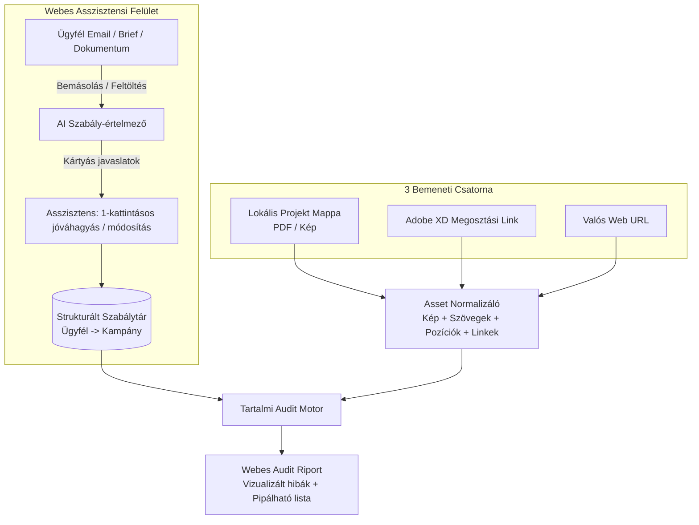

# Implementációs terv v3 – Tartalmi Megfelelőségi (Content Compliance) Audit Rendszer

> [!IMPORTANT]
> **Alapvető hatókör (Scope):** A rendszer kizárólag **tartalmi megfelelőséget** vizsgál (szövegek, jogi közlemények, logó- és márkaelem-használat, terméknevek és termékek vizuális szerepeltetése, elrendezési szabályok, linkek és adatok konzisztenciája). **Semmilyen nyomdai vagy prepress ellenőrzést (színprofilok, CMYK/RGB, felbontás, kifutó) nem végez.**

---

## 1. A Valós Ügynökségi Munkafolyamat és Főszereplő

A rendszer központi felhasználója az **Ügynökségi Asszisztens / Projektmenedzser**, nem pedig egy mérnök. Az ő napi valóságára épül a felület és a logika:

1. **Szabályok érkezése:** A szabályok nem csak statikus brandbookokból jönnek, hanem **folyamatos ügyfél-email kommunikációból**, chatből, briefekből, és kampány közben is állandóan módosulnak.
2. **Hierarchia:** **Ügyfél (Client) → Kampány (Campaign) → Csatorna/Asset**. Egy ügyfélnek (pl. Podravka, Bonbonetti) vannak általános örökletes szabályai, és vannak kifejezetten az adott kampányra érvényes szabályai (amelyek felülbírálhatják az általánosat).
3. **Anyagok (Assetek) forrásai (3 fő csatorna):**
   - **Lokális projekt mappák:** A grafikusok által a hálózati/lokális meghajtóra (`W:\...`) mentett kreatívok (PDF, JPG, PNG).
   - **Adobe XD megosztási linkek:** Webes/digitális tervek a fejlesztési és jóváhagyási fázisban.
   - **Valós (Live) URL-ek:** Az elkészült, élesített vagy staging weboldalak és landing page-ek.
   *(Videó és animáció <2%, így az első fázisokból teljesen kimarad.)*
4. **Kimenet:** Egyetlen, **az asszisztens számára könnyen átlátható online (webes) felület**, ahol mind a szabályokat, mind az audit eredményeket egyszerűen kezelheti.

---

## 2. Rendszerarchitektúra és Működési Folyamat

### 2.1. Modul 1: Email-alapú Szabály-bevitel és Kezelő (Rule Copilot)
Az asszisztensnek nem kell YAML/JSON fájlokat vagy bonyolult űrlapokat szerkesztenie.
- **Szabad szöveges bevitel:** Az asszisztens bemásolja az ügyféltől kapott email részletet (vagy feltölti a briefet/brandbookot) az adott Ügyfél vagy Kampány alá.
- **Automatikus szabály-kinyerés és ütközésvizsgálat:** A rendszer nyelvi modellje a szövegből emberi nyelven megfogalmazott, de a háttérben strukturált **szabály-kártyákat** generál.
  - Ha az új email egy korábbi szabályt módosít, a rendszer automatikusan felismeri: *"Ez az email módosítja a #12-es szabályt (Promóciós időszak). Lecseréljem erre?"*
- **Kártyás jóváhagyó felület:** Az asszisztens egyszerű kártyákon látja:
  - **Mi a szabály?** (érthető magyar mondat)
  - **Mire vonatkozik?** (Teljes ügyfélre VAGY csak az adott kampányra; minden felületre VAGY csak pl. webre/POS-re)
  - **Súlyosság:** Kötelező (Blokkoló) / Figyelmeztetés
  - **Referencia csatolás:** Ha a szabály egy konkrét logót vagy termékfotót említ, az asszisztens ide húzza be (drag & drop) a jóváhagyott referenciafájlt.

### 2.2. Modul 2: Bemeneti Konnektorok (A 3 Asset-forrás)
A rendszer mindhárom forrást egyetlen egységes belső formátumra (**Kép(ek) + Kinyert szövegek + Koordináták + Linkek/Metaadatok**) hozza:

1. **Lokális Mappa Konnektor (Fájlfigyelő / Tallózó):**
   - Közvetlenül látja a munkaállomás/szerver projektmappáit.
   - Az asszisztens kiválasztja a kampány mappáját, vagy a rendszer automatikusan figyeli az `Auditra_var` almappát.
   - PDF esetén közvetlenül kinyeri a szövegréteget (duplikáció-szűréssel, ahogy a Podravka anyagoknál láttuk) és rendereli a vizuális képet; raszteres képnél (JPG/PNG) szövegfelismerést (OCR) futtat.
2. **Adobe XD Link Konnektor:**
   - Az asszisztens beilleszti az `adobe.com/view/...` megosztási linket.
   - Egy automatizált böngésző (Playwright) megnyitja a tervet, végiglapozza az összes artboardot (képernyőt), kinyeri a képernyőképeket és a DOM/accessibility rétegben elérhető szövegeket és interaktív linkeket.
3. **Valós (Live/Staging) URL Konnektor:**
   - Megnyitja a weboldalt asztali (desktop) és mobil nézetben.
   - Kinyeri a teljes látható szöveget, a gombokat, a kimenő linkeket (ellenőrzi, hogy élnek-e), a képeket (alt-szöveggel és vizuális megjelenéssel), valamint teljes oldalas (full-page) képernyőképet készít a vizuális elrendezés ellenőrzéséhez.

### 2.3. Modul 3: Tartalmi Szabály-kategóriák és Ellenőrző Motor
A motor minden egyes szabályt a jellegének megfelelő legpontosabb eszközzel ellenőriz:

| Tartalmi Szabály Kategória | Mit vizsgál a rendszer? | Hogyan ellenőrzi? (Technológia) |
|---|---|---|
| **1. Kötelező és tiltott szövegek (Jogi, Promóciós)** | Szó szerinti disclaimerek, dátumok, URL-ek, árak, tiltott kifejezések, helyesírás. | **Determinisztikus szöveg- és mintaillesztés** a kinyert szövegen (érzéketlen a sortörésekre és réteg-duplikációkra). |
| **2. Terminológia és Terméknevek** | A márka- és terméknevek pontos írásmódja (kis/nagybetű, kötőjel, védett nevek). | **Ügyfél-szótár alapú ellenőrző** + nyelvi modell a szövegkörnyezet értelmezésére. |
| **3. Vizualitás: Logók és Termékek jelenléte** | A megfelelő logóváltozat van-e fent? A kötelező termékek (csomagolások) szerepelnek-e, és a jóváhagyott csomagolással? | **Vizuális detektálás + Referencia-összehasonlítás** (a szabálytárba feltöltött hivatalos logókkal/termékfotókkal vetve össze). |
| **4. Térbeli elrendezés és Hierarchia** | Elhelyezési szabályok (pl. hol legyen a logó, mi mekkora arányt foglalhat el, védőtávolság, elemek egymáshoz való viszonya). | **Elem-lokalizáció (Bounding Box)** + geometriai pozíció-számítás + vizuális döntési modell. |
| **5. Konzisztencia és Web-specifikus tartalom** | A kreatívon lévő dátum/nyeremény/URL megegyezik-e a kampány adataival és a céloldalon lévővel? Működnek-e a gombok? | **Kereszt-ellenőrzés** a kampány törzsadatai és a kinyert linkek/szövegek között. |

### 2.4. Modul 4: Az Asszisztensi Webes Felület (UI)
Egy tiszta, böngészőből elérhető belső webalkalmazás három fő nézettel:
1. **Kampány & Szabály Dashboard:**
   - Bal oldalon az Ügyfelek (pl. Podravka, Bonbonetti) és alattuk a Kampányok.
   - Középen az aktív szabályok listája (Örökölt ügyfélszabályok + Kampányszabályok).
   - Fent egy **"Új szabály emailből / szövegből"** szövegdoboz, ahová az asszisztens bármikor bemásolhatja a legfrissebb ügyfél-visszajelzést.
2. **Audit Indító:**
   - Három gomb/mező: *Mappa kiválasztása* | *Adobe XD link beillesztése* | *Weboldal URL beillesztése*.
3. **Interaktív Audit Riport:**
   - **Bal oldalon a vizsgált kreatív / weboldal**, amelyen színes keretek (bounding boxok) jelölik a megtalált elemeket és a hibák pontos helyét.
   - **Jobb oldalon a szabály-ellenőrzőlista:**
     - **Megfelelt (Zöld):** összecsukva, hogy ne zavarjon (kattintásra nyitható, mutatja, hol találta meg).
     - **Hiba (Piros):** kiemelve, mellette a pontos indoklás (mit várt a szabály vs. mit talált a képen/szövegben).
     - **Ellenőrzendő / Bizonytalan (Sárga):** ahol az AI nem 100%-ig biztos, ott az asszisztens egy kattintással dönthet (*Elfogadom* / *Hibának jelölöm*).
   - **1-kattintásos Grafikus / Fejlesztői Export:** Az asszisztens a piros és jóváhagyott sárga elemekből egyetlen gombnyomással generál egy átküldhető javítási listát (vagy annotált PDF-et) a grafikusnak/fejlesztőnek.

---

## 3. Modell- és Technológiai Réteg (A motorháztető alatt)

A modellek cserélhető munkások, amelyeket az adott feladathoz választunk (a 24 GB VRAM-os RTX 3090-en lokálisan, vagy OpenRouter API-n keresztül):

- **Szöveg- és struktúra-kinyerés:** `PyMuPDF` (PDF-ekhez), `Playwright` (Adobe XD és élő weboldalakhoz), dedikált OCR modell (raszteres képekhez és ívelt/zajszűrt feliratokhoz).
- **Email → Strukturált Szabály fordító:** Erős utasításkövető LLM (lokális vagy OpenRouter), amely a szabad szöveges ügyfél-emailekből JSON/kártya sémát és ellenőrzési lépéseket épít.
- **Gyors tartalmi döntéshozó (System 1):** `Clef-omni` (vagy `Clef-flash`) a strukturált, kalibrált valószínűségű eldöntendő kérdésekhez (igen / nem / bizonytalan).
- **Vizuális keresés, referencia-illesztés és lokalizáció:** `EmbeddingGemma 2` (a szabályok, logók és jóváhagyott csomagolások közös szöveg+kép kereséséhez) + `Florence-2` / VLM (a képi elemek pontos helyének megtalálásához és a szöveges indoklás megírásához).

---

## 4. Megvalósítási Ütemterv (Lépésről lépésre)

| Fázis | Fókusz | Kézbe vehető eredmény (Deliverable) |
|---|---|---|
| **1. Fázis: Asszisztensi UI váz + Szabálykezelő (Email → Szabály)** | Ügyfél/Kampány adatbázis (Podravka, Bonbonetti), webes felület alapja, szöveg/email bemásolása és kártyás szabályokká alakítása. | Az asszisztens fel tudja vinni a Podravka és Bonbonetti kampányok szabályait emailekből és dokumentumokból. |
| **2. Fázis: Lokális Mappa Audit (PDF és Képek) + Szöveges szabályok** | Lokális mappák beolvasása, PDF/kép szövegkinyerés (duplikáció-kezeléssel), szöveges és terminológiai szabályok automatikus ellenőrzése, vizuális riport. | A meglévő Podravka és Bonbonetti lokális kreatívokon lefut a teljes szöveges/jogi audit a webes felületen. |
| **3. Fázis: Vizuális Tartalmi Audit (Logók, Termékek, Elrendezés)** | Referencia-képek (logók, termékek) csatolása a szabályokhoz, vizuális detektálás, elrendezési szabályok és a döntési/VLM modellek bekötése. | A rendszer már a rossz logót, hiányzó terméket vagy hibás elhelyezést is bekarikázza a kreatívon. |
| **4. Fázis: Webes Konnektorok (Adobe XD + Élő URL)** | Playwright-alapú Adobe XD terv-beolvasó és élő weboldal-szkenner bekötése ugyanabba az audit motorba. | Ugyanazok a kampányszabályok egyetlen link beillesztésével ellenőrzik a webes terveket és kész oldalakat is. |
| **5. Fázis: Finomhangolás és Export** | Grafikusnak/fejlesztőnek küldhető hibalista-export, kivételek megjegyzése kampányon belül. | Éles ügynökségi használatra kész rendszer. |

---

## 5. Kampányindulás tanulságai: mit kell a rendszernek általánosan tudnia

A minta kampánymappa (brief, módosító jegyzet, ütemterv, jogi és márkadokumentumok) **csak azt mutatja meg, hogyan indul egy kampány és milyen típusú információ keletkezik**. A konkrét tartalmak nem ellenőrzési feladatok, hanem illusztrációk. Az alábbiak a belőlük levont **általános rendszerkövetelmények**.

### 5.1. Az audit az elsődleges ellenőrzés, nem egy extra lépés
- A rendszer célja a **humán ellenőrzési hibák kiküszöbölése**. Ma több ember, több ponton, kézzel ellenőriz (szöveg, dizájn, jogi tartalom). Ezt a feladatot a rendszer veszi át elsődleges ellenőrzőként.
- Az ember a **kivétel-kezelő**: csak a rendszer által nem eldönthető, bizonytalan vagy ellentmondásos esetekkel foglalkozik, és ő hagyja jóvá a szabályokat. Nem újraellenőrzi az egészet.
- Következmény a tervre:
  - Az audit **minden asset minden verzióján, minden munkafázisban** automatikusan lefut (tervezés, jóváhagyás előtt, fejlesztés, éles). A fázis nem a humán ellenőrzési pontok leképezése, hanem az, hogy **a rendszer minden ponton ellenőriz**.
  - A cél a **lefedettség**: a szabály-ellenőrzések teljes köre automatikus, a riport pedig megmutatja, mi lett ellenőrizve és mi nem (az "emberi" kategóriába csak ténylegesen nem automatizálható szabály kerül).
  - A kimenet nem felelős szerinti szűrés, hanem a **hiba pontos, javítható leírása** a készítő számára; az ember a vitás pontokat dönti el.
  - Sikermetrika: a ma kézzel kiszűrt hibatípusok hány százalékát fogja meg a rendszer, és mennyi a téves elfogadás (cél: nulla a blokkoló szabályokon).

### 5.2. Kampány-adatlap (tényadat) a szabályok mellett
A szabályokon túl kell egy **strukturált tényadat-gyűjtemény kampányonként** (időszak, mennyiségek, hivatkozások, kötelező megnevezések, kapcsolódó dokumentumok). Ez igazságforrás, amivel az assetek tartalmát össze kell vetni. Minden érték **forrást és dátumot** kap.

### 5.3. Időbeli változás és nyitott állapot
- A kampány információi menet közben **módosulnak** (új brief-részletek, ügyfél-jóváhagyás utáni pontosítások). A rendszernek **verziózott, felülírható** állapotot kell kezelnie: a későbbi hitelesebb forrás érvényes, a változás nyomon követhető, a jóváhagyott állapotot nem írja át automatikusan nem hiteles forrás.
- A kampány elején sok adat még **nyitott** (várt javaslat, hiányzó érték). Ezekhez "függőben" státusz tartozik: az audit ilyenkor nem hibát jelez, hanem "adat hiányzik" jelzést ad, és a nyitott kérdések az asszisztens felületén listázódnak.
- Egy módosítás **automatikusan újraauditot indít** az érintett asseteken.

### 5.4. Több szabályréteg és forrás
- Szabályok több helyről jönnek: ügyfél és márka, kampány, **partner/kereskedő**, **jogi** dokumentumok. A hierarchia: **Ügyfél → Márka → Kampány → Asset**, plusz csatolható partner- és jogi réteg. Minden szabály megmondja, honnan jön és ki hagyta jóvá.
- **Master dokumentumok:** egy kampányhoz tartozhat egy hivatalos, hosszú jogi/szabályozó dokumentum, amit az assetek rövidítve vagy hivatkozva hordoznak. Új szabálytípus: **mekkora közlés kötelező az adott csatornán/méreten, és mire kell hivatkozni**.
- A szabályhoz kötelező **hatókör** tartozik (mely assetekre/csatornákra érvényes). Ha hiányzik, a rendszer rákérdez, nem alkalmazza mindenre.

### 5.5. Asset-készlet, mutációk, hiánylista
- Egy kampány **összetartozó assetek sokasága**: eltérő csatornák, méretek, mutációk, verziók.
- Kell **kampány-szintű nézet**: mely elvárt leszállítandók vannak meg, melyek auditáltak, melyek elavultak vagy hiányoznak. Az elvárt leszállítandók a kampány-indító dokumentumokból (brief, ütemterv) származhatnak.
- **Mutációk csoportban** kezelendők, a csoport egyedei egymással is összevethetők (konzisztencia).
- **Verziók közti összevetés:** újraauditnál látszik, mi javult és mi új hiba.

### 5.6. Bemeneti formátumok robusztussága
A kampányanyag **sokféle formátumban és kódolásban** érkezik: szöveges fájlok eltérő kódolással, táblázatok, szöveges dokumentumok, e-mailek, linkek, nagyon nagy fájlok. Az ingestionnek ezeket kódolás-felismeréssel, háttérfeldolgozással kell tudnia kezelni, és a kinyert szabályt/tényt mindig **emberi jóváhagyás** után teszi élessé.

### 5.7. Videó
Videó/animáció kis arányú, az első körben nem auditáljuk. Nyilvántartásban "még nem auditálható" státusszal szerepeljen, hogy a kampány-hiánylistából ne tűnjön el.

### 5.8. Módosított kezdő ütemterv
- **F1:** Ügyfél → Márka → Kampány hierarchia, kampány-adatlap, szabály-verziózás és nyitott kérdések kezelése.
- **F2:** sokformátumú ingestion, kampány-szintű hiánylista, a minta kampány valós assetjeivel mint **ingestion- és működésteszt** (nem előre megírt konkrét ellenőrzések).
- Az éles szabályok mindig a valós ügyfélforrásokból jönnek jóváhagyással, nem a mintákból.

### 5.9. Nyitott kérdések
1. Hogyan érkeznek az ügynökséghez a partner/kereskedői és jogi elvárások (e-mail, dokumentum, felület)?
2. Ha két forrás ellentmond, melyik az irányadó? (Ez ügyfelenként konfigurálható forrás-prioritás lehet.)
3. Hol él ma a jóváhagyott jogi dokumentum verziója, és hogyan kapja értesítést a rendszer a változásról?
4. A ma kézzel végzett ellenőrzések listája (milyen hibatípusokat szoktak elkapni vagy elmulasztani?) honnan szerezhető meg a rendszer lefedettségi céljához?

---

## 6. Valós hibaminta tanulságai (korrekciós levelezésből)

A 10 minta-hiba **nem ellenőrzési feladatlista**, hanem a **hibatípusok szerkezetét** mutatja meg. A rendszerkövetelmények ebből az általános szerkezetből jönnek.

### 6.1. A hibák típusai (taxonómia-ellenőrzés)

| Megfigyelt hibatípus (általánosan) | Szabálytaxonómia-kategória | Jellemző ellenőrzési mód | Nehézség |
|---|---|---|---|
| Szó- vagy kifejezés helytelen írásmódja | Terminológia, szöveges tartalom | Determinisztikus, ügyfél-szójegyzék tiltott/helyes alakokkal | Alacsony |
| Elavult vagy téves referenciaelem (régi verzió) használata | Márkaelem / referencia-verzió | Referenciakönyvtár verziózással, képi összevetés | Közepes |
| Hibás termékváltozat | Termék-azonosítás | Finomszemcsés vizuális felismerés, csomagolásszöveg, termékadatbázis | **Magas** |
| Elrendezési minta (alakzat, sorrend, irány, közelség) | Elhelyezés és elrendezés | Elem-lokalizáció + relációk (sorrend, csoportosítás, távolság) | Magas |
| Elemek aránya egymáshoz képest | Elhelyezés/arány | Lokalizált elemek méretaránya, viszonyított küszöb | Közepes |
| Elemek takarása, ütközése, hely hiánya | Elrendezés/olvashatóság | Lokalizált dobozok átfedés- és szabad hely számítása | Közepes |
| Hangnem és megszólítási forma | Hangvétel | Szemantikai döntés, nyelvi modell | Közepes |
| Üzenet érvényességi köre (kire/hol vonatkozik) | Konzisztencia a kampány-adatlappal | Kereszt-ellenőrzés | Közepes |
| Kiemelendő üzenet nem elég hangsúlyos | Hangsúly/hierarchia | Viszonyított vizuális dominancia, **fokozatos** (nem bináris) értékelés | Magas |
| Leadott fájl szerkezete (szerkeszthetőség) | **Leszállítási forma**, nem tartalmi | Fájlstruktúra-vizsgálat | Külön kérdés (lásd 6.6) |

**Következmény:** a szabálytaxonómia lefedi a hibákat, a **nehéz** kategóriák (termékváltozat, elrendezési viszonyok, hangsúly) határozzák meg az F3 tartalmát és a modell-benchmarkot.

### 6.2. A legfontosabb új felismerés: a javítási kérés a legjobb szabályforrás
- A hibák a **visszajelzés-levelezésből** ismerhetők meg: az ügyfél/partner javítási kérései konkrét, ellenőrizhető elvárások.
- Új modul: **Korrekció-elemző (Feedback Miner)**. Ez beolvassa a korábbi és folyamatban lévő javítási e-maileket, és belőlük **jelölt szabályokat és tesztesetet** állít elő (hiba, helyes állapot, hatókör). A jelöltet az asszisztens hagyja jóvá.
- **Visszatérő hibák felismerése:** ha ugyanaz a javítási ok több assetnél vagy kampánynál előkerül, a rendszer javasolja **állandó szabállyá** emelni. Ez adja az ügyfélspecifikus "tanult" szabálykészletet.
- A korábbi levelezés egyben **gold dataset**: ismert hibás assetek és a hozzájuk tartozó javított változat az F2/F3 benchmarkhoz.

### 6.3. Javítási kérés = követendő ellenőrzési tétel (Revision Ledger)
- Sok kérés **az előző verzióhoz viszonyított változtatás** (nagyobb, kisebb, cserélni, áthelyezni). Ez az előző verzió ismerete nélkül nem ellenőrizhető.
- Új objektum: **Javítási főkönyv**. Minden beérkező javítási kérés tétel lesz egy asset-csoport alatt: "kért változás", forrás (levél), állapot (nyitott/teljesítve).
- Az új verzió auditja **ellenőrzi, hogy a kért változás megtörtént-e** (az előző és az új verzió összevetésével), és új hibát nem hozott-e be. A teljesítetlen kérés külön hibaként jelenik meg.
- Így a rendszer az újabb körös hibák egyik fő forrását, az "elfelejtett vagy rosszul végrehajtott javítást" is kiszűri.

### 6.4. Mutációk: közös mester + eltérő deltával
- Azonos kreatív több **partner/csatorna/kereskedő** változatban készül, eltérő hatókörrel és saját elvárásokkal, miközben a kampány közös.
- Szabályok **mutáció-szinten is** hatóköröznek (közös kampányszabály + változat-specifikus szabály). A mutációk egymással is összevethetők: mi tér el és az eltérés megengedett-e.
- A hiba gyakran **csak egy változatnál** jelentkezik, ezért a riportnak mutációnként kell visszajeleznie, és a csoport tendenciáit is mutatnia.

### 6.5. Termék- és referencia-törzsadat (Product & Asset Master)
- Hibatípusok közt szerepel a hibás termékváltozat és az elavult termékfotó. Ehhez kell **ügyfélenkénti termék-törzs**: termék/variáns azonosítók, megnevezés, jellemzők (pl. méret, íz), **aktuális és elavult** megjelenési képek.
- A referencia-képek **verziózottak és állapotuk van** (aktuális/kivonva). A kampány-adatlap hivatkozik, melyik termékeket kell szerepeltetni.
- A finomszemcsés termék-felismerés nehéz, ezért **többlépcsős**: csomagolásszöveg-leolvasás + vizuális referencia-összevetés + (ha kell) emberi megerősítés bizonytalanság esetén.

### 6.6. Viszonylagos, fokozatos szabályok
- Több elvárás **viszonyított** ("nagyobb", "hangsúlyosabb", "közelebb"). A rendszernek ezeket **mérhető viszonyokká** kell fordítania (méretarány, távolság, vizuális súly), és ahol nincs számszerű küszöb, **kalibrálni kell az ügyfél jóváhagyott/elutasított példáin**.
- Ezeknél az ítélet gyakran **fokozatos** (gyenge/elfogadható/erős), és a határesetet az ember dönti el. A döntések visszakerülnek kalibrációs adatnak.

### 6.7. Hatókör-kérdés: leszállítási forma
A mintában szerepel egy hiba, ami **a leadott fájl szerkezetére** vonatkozik (szerkeszthetőség). Ez nem nyomdai és nem tartalmi, hanem **leszállítási elvárás**. Javaslat: **opcionális modulként** kezeljük, az elsődleges hatókörön kívül. Dönts, hogy kell-e.

### 6.8. Hatás az ütemtervre
- **F1:** a Korrekció-elemző (levelezésből szabályjelölt) beépül a szabálybevitelbe, a Javítási főkönyv adatmodellként.
- **F2:** a korábbi javítási levelek és hozzájuk tartozó verziók mint **gold dataset** összegyűjtése.
- **F3:** először az alacsony és közepes nehézségű kategóriák (szöveg, terminológia, átfedés, arány, hatókör-egyezés), majd a nehezek (termékváltozat, elrendezési relációk, hangsúly) külön benchmarkkal.
- **F4:** verzióösszevetés és a javítási kérések teljesülésének automatikus ellenőrzése.

### 6.9. Nyitott kérdések
1. A leszállítási forma (pl. szerkeszthetőség) ellenőrzése benne legyen-e, opcionális modulként?
2. Hozzáférhető-e a korábbi javítási levelezés exportja (mappa, postafiók, ticket) a Korrekció-elemzőhöz?
3. Léteznek-e ügyfelenként termékadatok és jóváhagyott termékképek rendezett formában (törzsadat), vagy ezt is a levelezésből kell összeszedni?
4. Hány korábbi kampány áll rendelkezésre a gold datasethez?

---

## 7. Döntések és egyszerűsített első kör (felülírja a 6. fejezet vonatkozó részeit)

### 7.1. Levelezés-feldolgozás későbbre tolva
- A **Korrekció-elemző** (automatikus levélbeolvasás) **későbbi fázis**, nincs az első körben.
- **Első körben az asszisztens manuálisan vezeti a hibalistát** a webes felületen, a beérkező levelek alapján. Az adatmodell már most kész van az automatikus bővítésre, mert a kézi tétel és a későbbi automatikus tétel ugyanaz az objektum.

### 7.2. Kézi hibalista (Javítási főkönyv, egyszerű változat)
A felület **Hibalista** nézete, kampány → asset(csoport) alatt. Egy tétel gyorsan felvihető:

| Mező | Tartalom |
|---|---|
| Leírás | A kért változás vagy hiba saját szavaival (szabad szöveg) |
| Hatókör | Mely assetre vagy mutációra vonatkozik (egyre, többre, az egész kampányra) |
| Forrás | Levél tárgya/dátuma vagy beillesztett szövegrészlet (hivatkozás, nem automatikus beolvasás) |
| Típus | A taxonómia kategóriája (választható, vagy az AI javasolja) |
| Állandó szabály? | Jelölőnégyzet: legyen-e belőle tartós szabály a szabálytárban |
| Állapot | Nyitott / Teljesítve / Elutasítva |

Működés:
- Az **AI javasol**: a beírt szabad szövegből kitölti a típust, a hatókört, és felajánlja a szabállyá alakítást. Az asszisztens jóváhagy vagy módosít (ugyanaz a kártyás folyamat, mint az 2.1 pontban).
- **Új verzió beérkezésekor** a rendszer automatikusan ellenőrzi a nyitott tételeket (az előző és az új verzió összevetésével, ahol ez lehetséges), és javasolja a "Teljesítve" állapotot. Ami nem ellenőrizhető automatikusan, azt az asszisztens zárja le.
- A tétel, amit **állandó szabállyá** emeltek, a kampány vagy az ügyfél szabálytárába kerül, és minden későbbi assetnél lefut.
- A lezárt tételek (hiba, és a javított állapot) **gold dataset**-ként gyűlnek, így a későbbi automatikus levélfeldolgozás kész tesztanyagot kap.

### 7.3. Leadási jelölés (egyszerű, opcionális)
- A leszállított asset mellé **jelölők** rendelhetők a leadási elvárásokról (pl. "szerkeszthető forrás kell", "mutációk mind megvannak"), amiket a rendszer **megjelenít és ellenőriz, ahol egyszerűen lehet** (például hogy a kért forrásfájl típus ott van-e a mappában).
- **Nem** nyomdai ellenőrzés és **nem** fájl-tartalom mélyvizsgálat, csak a leadási csomag teljességének jelzése a kampány-hiánylistával együtt.
- Az elsődleges hatókör (tartalmi audit) fölé nem kerül, külön, kikapcsolható jelzés.

### 7.4. Frissített ütemterv (az eddigieket felülírja)

| Fázis | Változás |
|---|---|
| **F1** | Ügyfél → Márka → Kampány hierarchia, kampány-adatlap, szabálykártyák (szövegből), **kézi Hibalista**, leadási jelölők |
| **F2** | Sokformátumú ingestion, kampány-hiánylista, a lezárt hibalista-tételek gyűjtése gold datasetnek |
| **F3** | Automatikus ellenőrzés: előbb az alacsony és közepes nehézségű kategóriák, majd a nehezek külön benchmarkkal |
| **F4** | Verzióösszevetés: nyitott hibalista-tételek automatikus teljesülés-ellenőrzése |
| **Későbbi** | **Korrekció-elemző:** levelezésből automatikus tételek és szabályjelöltek |

### 7.5. Maradék nyitott kérdések
1. Melyik felület lesz az asszisztens első számú munkahelye (önálló webalkalmazás, vagy meglévő eszköz bővítése)?
2. A hibalistát ügyfelenként vagy kampányonként érdemes alapértelmezetten kezelni? (A javaslat: kampányonként, szűrhető ügyfél-szinten.)
3. Kezdjük-e az F1-et egy futó kampánnyal valós adatokkal (a hibalista kézi vezetésével párhuzamosan)?

---

## 8. Döntések: elérhetőség, hibalista-struktúra, kezdés kevés adattal

### 8.1. Bárhonnan elérhető, jogosultságkezelt kommunikációs felület
- A felület **webalkalmazás**, böngészőből bárhonnan elérhető, bejelentkezéssel. Nem kötődik a munkaállomáshoz.
- **Szerepkörök (kezdetben egyszerűen):**
  - **Admin:** felhasználók, ügyfelek, beállítások.
  - **Asszisztens / szerkesztő:** szabályok, hibalista, auditindítás, jóváhagyás (az elsődleges felhasználó).
  - **Megtekintő:** riportok és a hibalista olvasása (pl. grafikus, fejlesztő).
  - Hozzáférés **ügyfél- és kampányszinten** adható, egy felhasználó csak a neki engedélyezett ügyfeleket látja (NDA, bizalmasság).
- **Naplózás:** ki mit módosított (szabály, hibalista-tétel, jóváhagyás), visszakereshetően.
- **Architektúra-következmény (elkülönített rétegek):**
  - **Webes réteg** (felület, adatbázis, fájltár, jogosultság): bárhonnan elérhető helyen (szerver vagy felhő, biztonságosan).
  - **Feldolgozó réteg** (AI-modellek, ingestion): a **lokális RTX 3090-es gépen** vagy **OpenRouter API-n**, a webes réteg feladatsorából dolgozik. A kettő között titkosított, hitelesített kapcsolat van, így a munkaállomásnak nem kell közvetlenül az internetről elérhetőnek lennie.
  - A **lokális mappák** (munkaállomás/hálózati meghajtó) beolvasása a feldolgozó oldali konnektoron megy. A távoli felhasználó feltölthet is a felületre.
  - **Adatvédelmi profil ügyfelenként:** melyik ügyfél anyaga futhat felhő-API-n és melyik csak lokálisan.
- **Kommunikációs funkciók a felületen:** megjegyzések tételenként, @megjelölés, értesítés új auditról vagy hibalista-változásról, hogy a kommunikáció ne külön csatornán (e-mailben) szóródjon.

### 8.2. Hibalista felépítése
- **Fő csoport: Ügyfél. Alcsoport: Kampány.** A hibalista tételei a kampány alatt élnek (az 7.2 mezőivel, a hatókör az eszköz/mutáció szintet jelöli).
- Ügyfél-szinten a rendszer összesítő nézetet ad (nyitott tételek kampányonként, visszatérő hibatípusok), a kampányon belül a részletes lista.
- Az "**állandó szabály**" jelölt tétel a választott szintre kerül: **kampányra** (csak ott érvényes) vagy **ügyfélre** (minden kampányban).

### 8.3. Kezdés valós adat nélkül
Jelenleg csak a most körvonalazódó kampány kiinduló anyagai vannak meg, ami **valójában jó kiindulás**, mert a rendszer a kampánnyal együtt nő:
1. **Élő pilot:** a körvonalazódó kampány lesz az első éles kampány a rendszerben. A szabályok, a kampány-adatlap és a hibalista a kampány haladtával töltődnek, nem előre.
2. **Funkcionális alap, adat nélkül is:** F1 (hierarchia, jogosultság, szabálykártyák, hibalista, adatlap) valós ellenőrzendő anyag nélkül is felépíthető és tesztelhető.
3. **Teszt-anyag a modellekhez:** a kampány első elkészült assetei mellé **szándékosan hibásított változatok** készíthetők (a szabályok ismert megsértésével), így a rendszer automatikus ellenőrzését akkor is mérni tudjuk, ha még nincs valódi hibatörténet. A 10 hibás mintán ismertetett hibatípusok szerkezete (6. fejezet) a hibásítás **kategóriáit** adja, nem konkrét tartalmát.
4. **Gold dataset építése futás közben:** minden lezárt hibalista-tétel (hiba és javított változat) bekerül a teszthalmazba.
5. **Későbbi ügyfelek:** a második ügyfél felvétele ellenőrzi, hogy a rendszer valóban ügyfélfüggetlen.

### 8.4. Végleges kezdő ütemterv

| Lépés | Tartalom | Eredmény |
|---|---|---|
| **0. Alap** | Webes váz, bejelentkezés, szerepkörök, Ügyfél → Kampány hierarchia, adatbázis, fájltár | Az asszisztens bejelentkezhet és felvehet ügyfelet/kampányt |
| **1. Szabály és adat** | Kampány-adatlap, szabálykártyák szövegből (AI-javaslat és jóváhagyás), verziózás, nyitott kérdések | A pilot kampány szabályai és tényadatai kezelhetők |
| **2. Hibalista és kommunikáció** | Kézi hibalista (Ügyfél → Kampány), megjegyzések, értesítések, leadási jelölők | A kampány hibái egy helyen követhetők |
| **3. Ingestion és audit-mag** | Fájl-/mappa- és feltöltés-konnektor, szövegkinyerés, determinisztikus szabályok, riport | Az első assetek automatikus tartalmi auditja |
| **4. Vizuális és szemantikai audit** | Elem-lokalizáció, referencia-összevetés, döntési modell, modell-benchmark a hibásított tesztanyagon | Logó, termék, elrendezés, hangnem ellenőrzés |
| **5. Webes konnektorok és verzióösszevetés** | Adobe XD, élő URL, nyitott hibalista-tételek automatikus lezárás-javaslata | Teljes csatornalefedés |
| **Későbbi** | Levelezésből automatikus tételfeldolgozás, videó, második ügyfél | Skálázás |
